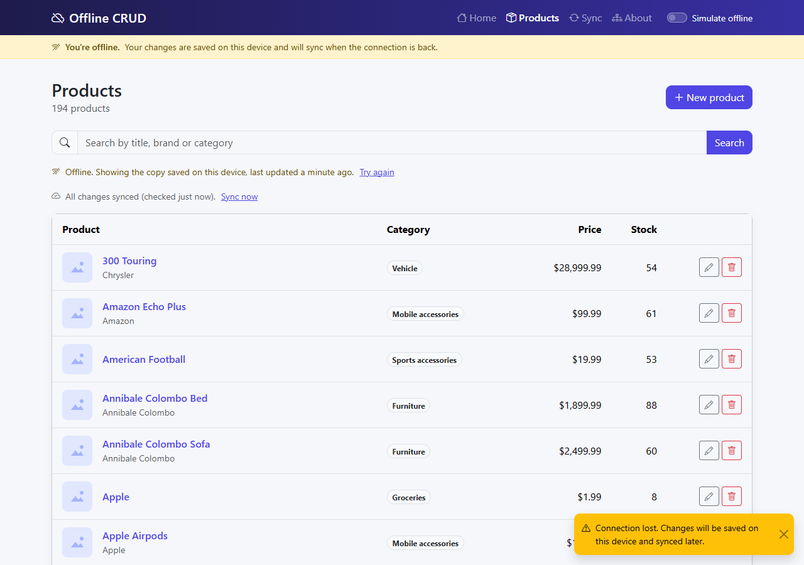
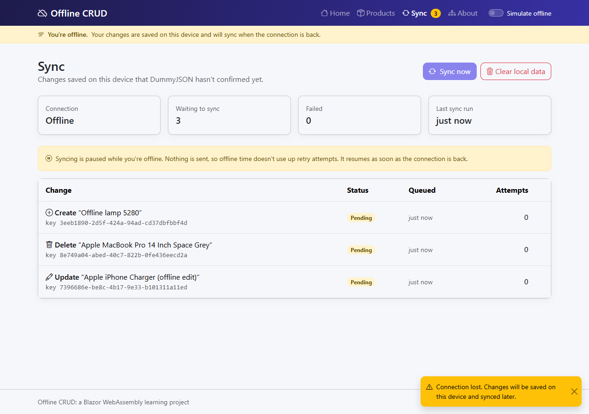

# Offline CRUD: an offline-first Blazor WebAssembly app

A product catalogue that runs entirely in the browser and keeps working without a network. Changes are saved on the
device first, queued in an outbox, and synced to the API when a connection is available. The published build even
starts with no network at all.

It's a teaching project. The code is heavily commented (`grep -rn "LEARN:" src`), and it was built in phases, each
written up in [`docs/LEARNING.md`](docs/LEARNING.md).

| Offline: the saved catalogue, with the offline banner | Offline: three changes queued, syncing paused |
| --- | --- |
|  |  |

## What it demonstrates

- **Blazor WebAssembly vs Blazor Server:** .NET running in the browser tab, with `HttpClient` as `fetch()`, a single
  thread, and no server connection to lean on.
- **Local-first data:**
  - IndexedDB (through a hand-written JS module) is the UI's source of truth;
  - reads are stale-while-revalidate;
  - client-generated ids;
  - version-based merging and tombstones.
- **The transactional outbox:** each write saves the product and an outbox entry in one IndexedDB transaction. A sync
  engine replays the entries in order per product, with idempotency keys, exponential backoff with jitter, coalescing,
  and readable permanent failures with Retry and Discard.
- **Connectivity:** `navigator.onLine` plus real request outcomes, a "Simulate offline" switch, an offline banner, and
  toasts.
- **PWA app shell:** a service worker caches the whole app so it starts offline, and offers a reload when an update
  arrives.
- **Clean Architecture in a browser app:** Domain and Application are plain .NET; browser specifics live in
  Infrastructure; `Program.cs` in the client is the composition root.

## Quick start

Needs the [.NET 10 SDK](https://dotnet.microsoft.com/download) (pinned in `global.json`) and an internet connection for
the first load.

```powershell
dotnet run --project src/OfflineCrud.Client
```

Then open http://localhost:5121. In Visual Studio, set **OfflineCrud.Client** as the startup project and press F5.

**See the pattern in under a minute:**
1. Open **Products**. The catalogue (194 products) downloads into the browser.
2. Switch on **Simulate offline** in the menu bar, or use DevTools → Network → Offline.
3. Edit a product, create one, delete one. Each change shows straight away and is marked as not synced. **Sync** shows 3.
4. Switch it off. A toast says "Synced 3 changes" and the outbox empties.

**Offline start-up** only exists in a published build, because `dotnet run` uses a service worker that does nothing:

```powershell
./scripts/publish-and-serve.ps1     # publishes, checks the app shell has no external dependencies, serves on :5200
```

Open http://localhost:5200 and wait until DevTools → Application → Service workers shows the worker as *activated*.
Then go offline (or stop the server) and reload: the app still starts.

## Tests

```powershell
dotnet test                                   # unit and component tests (NUnit, Moq, bUnit)
cd tests/e2e; npm install; npm test           # end-to-end tests in your installed Edge (Playwright, Node 20+)
```

| Project | What it covers |
| --- | --- |
| `tests/OfflineCrud.Application.Tests` | Domain rules, merging, coalescing, retry policy, the sync engine (against an in-memory store), architecture rules |
| `tests/OfflineCrud.Infrastructure.Tests` | The DummyJSON client against a stub HTTP handler, record mapping, connectivity, module loading |
| `tests/OfflineCrud.Client.Tests` | bUnit component and page tests: forms, dialogs, banners, the products and sync pages |
| `tests/e2e` | Real browser: clean start-up, the offline flow, and the published build starting **with the server stopped and the network off**, then syncing ([details](tests/e2e/README.md)) |

## Project structure

```
src/
  OfflineCrud.Domain/          Products and their rules. No dependencies.
  OfflineCrud.Application/     Use cases, the sync engine, and the ports below.
  OfflineCrud.Infrastructure/  Browser implementations: IndexedDB (wwwroot/js/indexedDb.js), the DummyJSON HttpClient,
                               connectivity (wwwroot/js/connectivity.js).
  OfflineCrud.Client/          Blazor WebAssembly PWA: pages, components, service worker, DI composition root.
tests/                         See above.
tools/serve.cs                 Static server for the publish output (a .NET 10 file-based app).
scripts/publish-and-serve.ps1  Publish, check, serve.
docs/                          Learning notes, interview notes, API notes.
```

Dependencies point inward only: Client → Application → Domain, and Infrastructure → Application. The Client references
Infrastructure only so `Program.cs` can register it. Architecture tests enforce this.

## The API

Data comes from [DummyJSON](https://dummyjson.com)'s `products` resource. It accepts creates, updates and deletes but
**doesn't keep them**, and gives every created product id 195. The app handles this on purpose:
- the device is the source of truth and the API is a sync target;
- local edits and deletes survive refreshes;
- an update to a product DummyJSON never stored fails with a readable reason, and you can Retry or Discard it.

What was verified against the real API is in [`docs/api-notes.md`](docs/api-notes.md). How it would behave against a
real API (ETags, server-side idempotency) is in `docs/LEARNING.md`, Phase 3.

## Documentation

- [`docs/LEARNING.md`](docs/LEARNING.md): one section per phase (what was built, key concepts, gotchas, things to try),
  with the commit that ends each phase so you can check out and run any stage.
- [`docs/interview-notes.md`](docs/interview-notes.md): condensed talking points (WASM vs Server, offline-first, the
  outbox, IndexedDB, service workers, trade-offs, production).
- [`docs/offline-crud-spec.md`](docs/offline-crud-spec.md): the original brief.
- [`CLAUDE.md`](CLAUDE.md): conventions and architecture rules for working on the code.

## Working on it

- Branches: `main` (releases), `dev` (integration). Work happens on `feature/…` or `fix/…` branches from `dev` and
  is merged through pull requests.
- Commits follow [Conventional Commits](https://www.conventionalcommits.org/) (`feat:`, `fix:`, `docs:`, `test:` …).
- Builds treat warnings as errors. Run `dotnet build` and `dotnet test` before committing.
